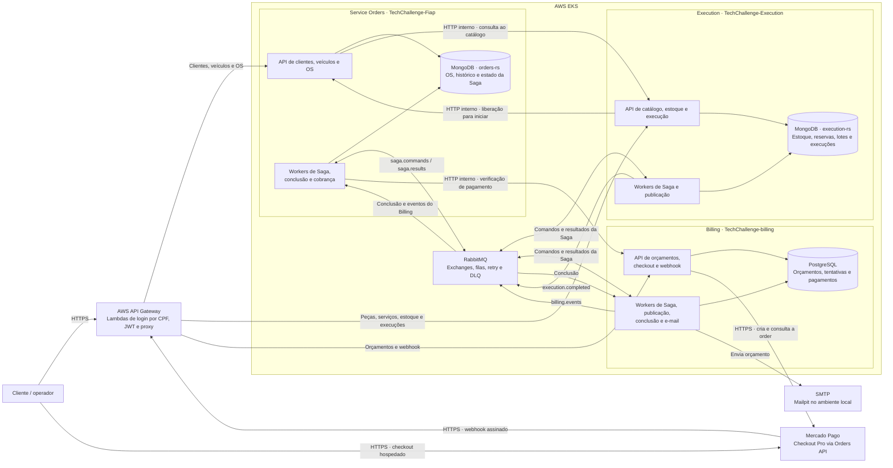
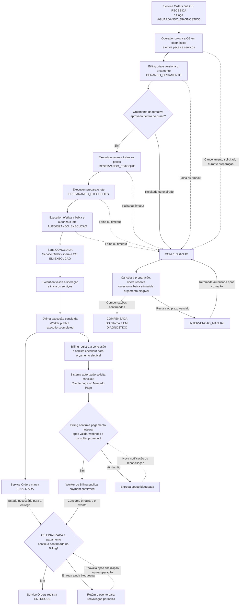
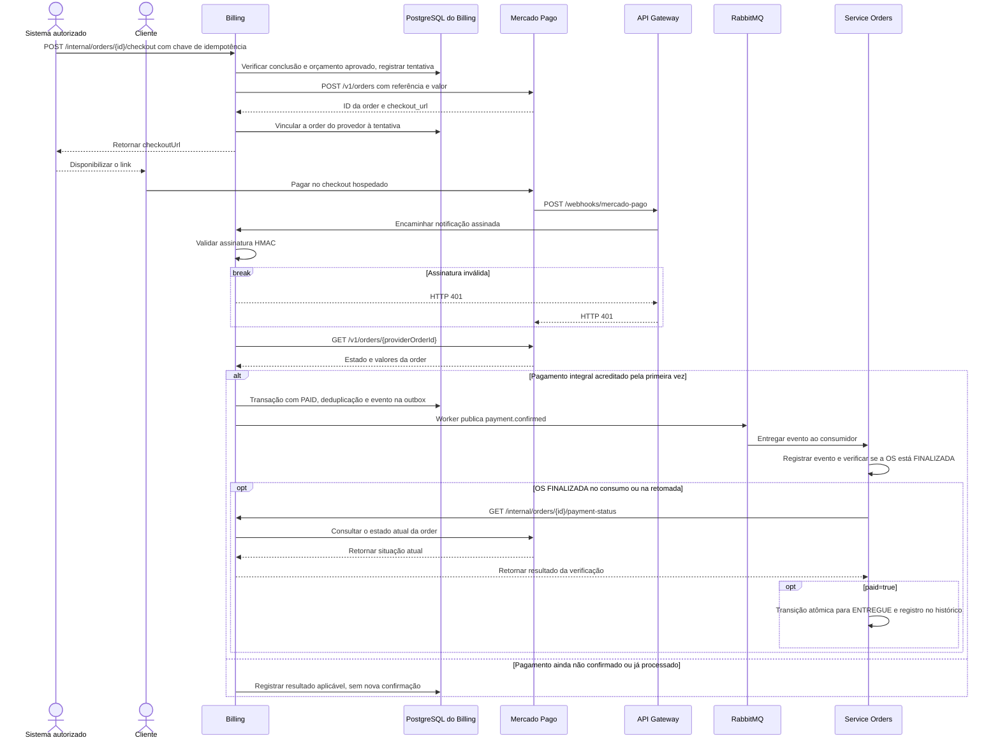

# Arquitetura final da oficina

A aplicação da oficina tem três microsserviços. **Service Orders** controla a ordem de serviço (OS), **Execution** controla o estoque e os serviços da oficina, e **Billing** controla orçamentos, pagamentos e a integração com o Mercado Pago. Cada serviço tem sua própria API, workers e banco. A OS liga os registros pelo seu identificador, enquanto cada serviço mantém seus dados e aplica suas regras localmente.

## Arquitetura e comunicação

- **HTTP síncrono.** Usado para solicitações do cliente e verificações que exigem uma resposta, como consultar preços, checar se a execução pode iniciar e verificar o pagamento antes da entrega. Em AWS, as rotas protegidas de `/api` passam pela autenticação JWT do Gateway. Localmente, o Service Orders emite o JWT usado pelos três serviços. As rotas `/internal` usam `x-internal-api-key` e ficam fora da exposição pública do Gateway.
- **AMQP assíncrono.** O RabbitMQ transporta comandos e resultados da Saga e eventos de conclusão e cobrança. O produtor publica a partir do próprio banco, e cada consumidor atualiza seus dados. Isso permite que a conclusão da execução seja processada por Billing e Service Orders em momentos diferentes.
- **Isolamento de dados.** Cada serviço acessa diretamente apenas o banco que possui. Os bancos MongoDB usam replica sets independentes para suportar as transações de Service Orders e Execution. Billing guarda valores monetários em centavos e preserva a versão do orçamento associada à cobrança.

| Emissor | Exchange e mensagens | Filas e efeitos |
| --- | --- | --- |
| Service Orders | `saga.commands` com rotas `billing.*` e `execution.*` | `billing.saga.commands` e `execution.saga.commands` executam os comandos |
| Billing e Execution | `saga.results` com rota `saga.result` | `service-orders.saga.results` correlaciona resultados e a decisão do orçamento com a tentativa |
| Execution | `execution.events` com `execution.completed` | `service-orders.execution` finaliza a OS e `billing.execution` registra a conclusão para habilitar a cobrança |
| Billing | `billing.events` com `estimate.#` e `payment.#` | `service-orders.billing` registra os eventos e avalia a entrega quando recebe `payment.confirmed` |

## Saga Pattern

A preparação é uma **Saga por orquestração**. O Service Orders persiste a fase, o prazo, a versão do estado e o identificador de cada tentativa. Ele envia um comando ao serviço responsável e decide a próxima etapa após receber o resultado correspondente. Billing decide sobre o orçamento e Execution aplica as regras de estoque e execução. A coordenação centraliza a ordem dos passos, o prazo de aprovação e a compensação, mantendo as regras de cada domínio no respectivo serviço. Após a liberação, conclusão e pagamento seguem por consumo de eventos, com verificações HTTP nos pontos que exigem o estado atual.

O fluxograma abaixo também está disponível em [formato Mermaid (.mmd)](FLUXO-ORDEM-DE-SERVICO.mmd).

**Caminho de sucesso.** Com `SAGA_ENABLED=true`, criar uma nova OS grava a ordem e a tentativa na mesma transação. Enviar os itens do diagnóstico fixa o conteúdo da tentativa e dispara `billing.CriarOrcamento`. A reserva de peças começa após a aprovação da versão exata do orçamento. O coordenador envia, em ordem, `execution.ReservarEstoque`, `execution.PrepararExecucoes` e `execution.AutorizarExecucao`. A reserva de todas as peças é atômica no Execution. Ao autorizar o lote, o Execution converte a reserva em baixa de estoque. O início do trabalho exige também a liberação da OS pelo Service Orders.

**Compensação.** Rejeição, expiração, falha de negócio, timeout técnico ou cancelamento solicitado antes do encerramento iniciam a sequência `execution.CancelarPreparacao` → `execution.LiberarEstoque` → `billing.CancelarOrcamento`. Os participantes desfazem os efeitos aplicáveis e guardam o histórico de cancelamento ou estorno. Uma tentativa com compensação confirmada devolve a OS ao diagnóstico, onde novos itens podem ser submetidos. Compensações recusadas ou vencidas exigem intervenção manual. O escopo cobre efeitos reversíveis da preparação até a liberação da execução física. Os prazos padrão são sete dias para o orçamento, cinco minutos para etapas técnicas e trinta minutos para a confirmação da compensação.

**Consistência e retomada.** Cada etapa confirma estado, recibo de mensagens (inbox) e publicações pendentes (outbox) em transações locais, quando aplicável. O worker publica mensagens persistentes com confirmação do broker. Os consumidores reconhecem mensagens após o processamento e deduplicam reentregas pelos identificadores persistidos. O coordenador correlaciona `orderId`, `sagaId`, `attempt`, `commandId` e versão do orçamento. Os participantes guardam cancelamentos para impedir que um comando atrasado recrie efeitos já compensados. Falhas transitórias seguem para retry, e mensagens inválidas ou com tentativas esgotadas vão para a fila de mensagens mortas (DLQ). Entre os commits locais, a consistência é eventual.

**Operação.** `GET /api/ordensServico/:id/saga` expõe a etapa e a tentativa. `POST /api/ordensServico/:id/saga/cancelar` solicita compensação. A retomada em intervenção manual usa `POST /internal/sagas/:sagaId/retry`. A flag de ativação se aplica a novas OS, e os workers processam tentativas em andamento mesmo após a flag ser desativada.

**Conclusão da execução.** Com o transporte RabbitMQ ativo, o Execution grava a conclusão da última execução e o evento `execution.completed` na mesma transação local. Um worker publica o evento, e Service Orders e Billing o processam de forma independente. O primeiro avança a OS para `FINALIZADA` e o segundo vincula a conclusão ao orçamento aprovado elegível para cobrança.

## Mercado Pago e entrega automática

O Billing integra o **Checkout Pro via Orders API**. Depois que o Billing consome `execution.completed`, um sistema autorizado solicita o checkout com `POST /internal/orders/:id/checkout`, usando `x-internal-api-key` e uma `idempotency-key` em formato UUID. O Billing exige que o orçamento aprovado mais recente corresponda ao orçamento vinculado à conclusão. Ele cria uma tentativa local, usa o ID dela em `external_reference` e envia a mesma chave em `X-Idempotency-Key` ao provedor. Em caso de timeout, a repetição com a mesma chave recupera a tentativa. O cliente paga na página hospedada pelo Mercado Pago.

- **Autenticidade e valor.** O endpoint do webhook recebe `x-signature`, `x-request-id` e `data.id`. O Billing verifica a assinatura HMAC-SHA256 com o segredo da aplicação e consulta o provedor com o Access Token do servidor. Para confirmar, vincula a referência e o ID da order à tentativa local, valida moeda `BRL`, confere o valor original e o valor integral pago e exige `processed/accredited`. O retorno do navegador serve à navegação. As credenciais vêm dos secrets `MERCADO_PAGO_ACCESS_TOKEN` e `MERCADO_PAGO_WEBHOOK_SECRET`.
- **Entrega automática.** O Service Orders exige a OS em `FINALIZADA`, o evento `payment.confirmed` registrado e uma consulta autenticada cujo resultado atual seja `paid: true`. Se a confirmação chegar antes da finalização ou a consulta falhar, o consumidor mantém a OS e volta a avaliar confirmações registradas. A transição condicional protege o histórico contra entregas duplicadas. A atualização manual por HTTP também exige pagamento confirmado na consulta ao Billing.
- **Reconciliação e reversão.** Uma notificação perdida pode ser recuperada com `POST /internal/payments/:id/reconcile`. Pagamentos pendentes ou rejeitados aguardam resolução sem liberar entrega. Estornos totais, parciais e chargebacks são registrados como `REVERSED`. Quando revertem um pagamento confirmado, o Billing publica `payment.reversed`. O tratamento da reversão é manual, inclusive para uma OS já entregue.

## Divisão e escolhas tecnológicas

| Decisão | Justificativa |
| --- | --- |
| **Service Orders** mantém cadastro, OS, histórico e coordenação | A transição da OS pertence a um único serviço e fica ligada ao estado da Saga. A OS referencia o catálogo e as cobranças pelos contratos dos serviços responsáveis. |
| **Execution** reúne catálogo, estoque e execução | Reservar peças, preparar lotes e controlar o início dos serviços envolvem as mesmas regras operacionais. Mantê-las no mesmo serviço permite transações locais sobre reservas, movimentos e lotes. |
| **Billing** reúne orçamento, e-mail e pagamento | A cobrança depende da versão aprovada do orçamento e da conclusão registrada. Guardar esses vínculos no mesmo banco facilita verificar a elegibilidade, deduplicar webhooks e publicar confirmações de forma transacional. O cliente Mercado Pago fica encapsulado no Billing. |
| **Node.js 20, TypeScript e Express** | Reaproveitam a base da aplicação original. Tipos explícitos ajudam a manter os contratos de API e mensagens. A Clean Architecture deixa regras e casos de uso acessíveis por portas, com HTTP, bancos, broker e provedor atrás de adaptadores. |
| **MongoDB para Orders e Execution** | Preserva o modelo documental de ordens, histórico e execução. Os replica sets habilitam transações locais para operações que precisam gravar dados de negócio e mensagens pendentes juntas. |
| **PostgreSQL para Billing** | Transações, restrições e índices dão suporte ao versionamento de orçamentos, ao vínculo da execução com a cobrança, à idempotência das tentativas e à escrita atômica da outbox. |
| **HTTP REST e RabbitMQ** | HTTP atende consultas e validações imediatas. RabbitMQ desacopla o processamento de eventos, distribui a conclusão a mais de um consumidor e oferece filas de retry e DLQ. A aplicação trata reentregas com idempotência. |
| **Docker, EKS, Terraform e GitHub Actions** | Compose reproduz os processos locais. A infraestrutura existente provisiona a base e as rotas em AWS. O Kubernetes separa APIs e workers em deployments. O pipeline constrói imagens, publica no Docker Hub e aplica os manifests de cada serviço. |
| **New Relic, Fluent Bit e logs estruturados** | A instrumentação cobre APIs e workers. Campos como `orderId`, `sagaId`, `commandId` e `messageId` permitem acompanhar o fluxo entre serviços. O broker conserva cópias de auditoria das publicações por 24 horas em filas `audit.*`. |

## Ambientes e validação

- **Local.** Cada repositório tem seu Compose. O Billing inicia PostgreSQL, RabbitMQ e Mailpit. Service Orders e Execution usam bancos MongoDB próprios e apontam para o mesmo broker e vhost. As portas padrão das APIs são Service Orders (3000), Execution (3001) e Billing (3002). Para exercitar o fluxo descrito, configure `SAGA_ENABLED=true` no Service Orders e `EXECUTION_COMPLETION_TRANSPORT=rabbitmq` no Execution.
- **AWS.** O desenho usa o mesmo EKS para os três serviços, com três APIs e três grupos de workers. O HPA de cada API escala de uma a quatro réplicas com alvo de 60% de CPU. Os workers são configurados com uma réplica por serviço. Os repositórios de infraestrutura mantêm o cluster, os bancos e broker, e as rotas/autenticação do API Gateway. O webhook público em HTTPS vai ao Billing, com autenticação pela assinatura do provedor.
- **Verificação de ponta a ponta.** O cenário de aceite cobre OS nova, aprovação do orçamento, reserva, execução, checkout com credenciais de teste, notificação real do Mercado Pago e uma única transição para `ENTREGUE`. Os cenários de rejeição de orçamento, estoque insuficiente, webhook duplicado, pagamento pendente e estorno anterior à entrega verificam os caminhos alternativos. A elaboração deste documento foi feita por inspeção do código e dos manifests, sem executar o pagamento nem a implantação no EKS. [Roteiro de teste do Mercado Pago](https://github.com/RuannGodinho/TechChallenge-Fiap/blob/4739660/docs/TESTE-MERCADO-PAGO.md)

## Referências do projeto

- Service Orders, `release` em `4739660`. [Saga](https://github.com/RuannGodinho/TechChallenge-Fiap/blob/4739660/docs/SAGA.md), [RabbitMQ](https://github.com/RuannGodinho/TechChallenge-Fiap/blob/4739660/docs/RABBITMQ.md), [Kubernetes](https://github.com/RuannGodinho/TechChallenge-Fiap/blob/4739660/docs/KUBERNETES.md) e [New Relic](https://github.com/RuannGodinho/TechChallenge-Fiap/blob/4739660/docs/NEW-RELIC.md).
- Execution, `feat/execution` em `a1ac85e`. [Implementação e configuração do serviço](https://github.com/RuannGodinho/TechChallenge-Execution/tree/a1ac85e).
- Billing, `feat/billing` em `c87507d`. [Implementação e configuração do serviço](https://github.com/RuannGodinho/TechChallenge-billing/tree/c87507d) e [cliente Mercado Pago](https://github.com/RuannGodinho/TechChallenge-billing/blob/c87507d/src/mercado-pago.ts).
